# 实验报告

## 实验基本信息

| 项目 | 内容 |
|------|------|
| **实验名称** | Lab2：物理内存和页表 |
| **小组成员** | 2510718-李东、2511102-沈弋皓、2511170-郑贺文 |
| **完成日期** | 2026-10-18 |

### 小组分工

| 成员 | 练习与代码工作 | 报告工作 |
|------|----------------|----------|
| 2510718-李东 | 编写 Buddy、SLUB 部分代码， 并且编写各自测试函数完成正确性检验 | 汇总其余两人对应部分实验报告，并完成实验报告撰写和检查 |
| 2511102-沈弋皓 | 完成内存范围思考题；维护公共入口、头文件和构建配置；汇总代码，执行各配置测试、评分及 GDB 调试 | 完成4.1、4.2，和第五章全部内容的撰写 |
| 2511170-郑贺文 | 实现 Best-Fit；完成模块验证 | 完成4.3、4.4内容的撰写 |

---

## 一、实验目的

1. 理解设备树提供的物理内存信息，建立物理地址、内核虚拟地址、物理页号和 `struct Page` 描述符之间的对应关系。
2. 实现页面初始化，区分保留区与可分配区，并通过统一的物理内存管理接口登记空闲页。
3. 比较 First-Fit、Best-Fit 与 Buddy 的选块、拆分和合并方式，理解外部碎片、内部碎片及管理成本。
4. 完成简化 SLUB 任务，在页分配之上提供小对象和大对象的分配、释放与复用。
5. 通过 GDB 观察 QEMU 的 Sv39 地址翻译及软件 TLB 填充过程。
6. 通过模块分工、测试和验证，协作完成内存管理功能的实现与集成。

---

## 二、实验环境

使用的 AI 工具

| 成员 | AI 编程工具 | 底层模型 | 备注 |
|------|------------|---------|------|
| 2510718-李东 | codex桌面版 | GPT-6 Astra 极高 | 无 |
| 2511102-沈弋皓 | OpenAI Codex 桌面应用 | GPT-5.6 Sol | 无 |
| 2511170-郑贺文 | Codex 桌面应用 | GPT-6 Astra | 无 |

---

## 三、实验整体逻辑分析

### 3.1 实验的逻辑主线

本实验解决两个相互关联的问题。其一是“哪些物理页面可用，怎样分给内核并回收”，对应页面初始化和各分配算法；其二是“内核访问一个虚拟地址时，实际访问哪段物理内存”，对应启动页表、Sv39 翻译和 TLB。

页表负责虚拟地址到物理地址的映射，`Page` 描述符和空闲链表记录页面的分配状态。SLUB 取得物理页后，通过内核映射访问页面，在页内存放管理头和对象。

### 3.2 功能的逐步实现

1. 启动汇编设置页表与 `satp`，进入内核虚拟地址空间。`kern_init()` 清理 BSS 并调用 `dtb_init()` 取得 RAM 信息。
2. `pmm_init()` 选择页分配器并初始化其内部结构，随后由 `page_init()` 建立描述符、保留内核元数据区域，将完整空闲页交给所选分配器。
3. First-Fit 作为阅读对象帮助理解统一接口；Best-Fit 在同一框架中选择最小足够块，默认构建使用它完成基础评分。
4. Buddy 将空间组织为按 2 的幂对齐的块，申请时拆分，释放时合并真正伙伴；其测试使用独立的描述符测试区验证分配状态。
5. 开启 SLUB 测试时，`kern_init()` 在 PMM 初始化及自检后调用 `slub_init()`、`slub_check()`。
6. 使用双 GDB 调试采集地址翻译与 TLB 证据，并结合启动页表和 QEMU 源码解释观察结果。

---

## 四、实验内容与实现

### 4.1 功能模块一：物理内存探测与页描述符初始化

**负责人：2511102 沈弋皓**

#### 4.1.1 模块功能与核心函数

`page_init()` 确定可供分配器使用的物理页面。`dtb_init()` 解析 OpenSBI 传入的 DTB，`get_memory_base()` 和 `get_memory_size()` 返回 RAM 起点与容量。本次 RAM 从 `0x80000000` 开始，大小为 128 MiB。

该函数按以下顺序完成初始化：

1. 读取 `mem_base` 与 `mem_size`，检查零值、加法溢出及地址范围；RAM 起点须为 `DRAM_BASE`，末端不超过 `0x88000000`，条件不成立时调用 `panic()`。
2. 设置虚拟地址与物理地址之间的固定偏移 `va_pa_offset`，并由内存末地址计算 `npage`。这里 `npage` 是物理地址空间末端的物理页号，而实际需要建立的描述符数量为 `npage - nbase`。
3. 将 `pages` 数组放在内核 `end` 符号之后，并向上对齐到 4 KiB。`pages` 中每个 `struct Page` 对应一个物理页，保存保留标志、引用计数、空闲块属性和链表节点等管理信息。
4. 先将全部页描述符标记为 `Reserved`，再登记可分配区间，保留内核映像、启动栈、页表和页描述符数组占用的页面。
5. 计算页描述符数组末端，将其转换为物理地址并向上按页对齐，得到 `free_start`；将物理内存末端向下按页对齐，得到 `free_end`。
6. 调用统一入口 `init_memmap(pa2page(free_start), free_count)`，由当前选择的 PMM 将该安全区间登记为空闲页面。
7. 初始化完成后检查地址偏移、页数、对齐、保留区状态、空闲页计数和页地址往返转换；任何后置条件失败都会触发 `panic()`。

本次运行中的关键数据为：

```text
物理内存范围：       [0x80000000, 0x88000000)
物理内存大小：       128 MiB
Page 描述符数量：    32768
pages 虚拟地址：     0xffffffffc0207000
空闲物理内存范围：  [0x80347000, 0x88000000)
空闲页数：           31929
```

128 MiB 一共包含 32768 个 4 KiB 页面，其中前 839 页保存固件使用区域、内核、启动数据、页表和 `pages` 数组，因此最终即为 31929 个空闲页。

---

### 4.2 Challenge：硬件可用物理内存范围的获取方法

**负责人：2511102 沈弋皓**

#### 4.2.1 思考题回答

操作系统若不能预先写死物理内存范围，通常应从启动固件或平台描述中取得内存映射，而不是直接把整个地址空间当作RAM：

1. RISC-V、ARM等平台常使用设备树 DTB/FDT。固件或引导程序将 DTB 地址传给内核，内核读取其中的 `memory` 节点和保留区域。
2. 传统 x86 启动可以通过 BIOS E820 接口取得内存映射，区分可用RAM、保留区、ACPI区域等类型。
3. UEFI 系统可以使用固件提供的内存映射服务，获得每一段内存的地址、长度和属性。
4. 对固定嵌入式平台，也可以从平台规范、启动参数或内存控制器配置寄存器获得容量。
5. 在没有可靠固件信息时可以尝试探测内存，但访问不存在或属于 MMIO 的地址可能产生异常或破坏设备状态，因此只能作为受控环境下的最后手段。

#### 4.2.2 方法比较与本实验的联系

固件内存映射能区分可用 RAM 与保留区域，因此比直接读写地址探测内存更安全。

本实验采用 DTB。OpenSBI进入内核时通过 `a1` 寄存器传入设备树物理地址 `0x82200000`，`dtb_init()` 解析出：

```text
Base: 0x80000000
Size: 0x08000000（128 MiB）
End:  0x87ffffff
```

---

### 4.3 理解 First-Fit 连续物理内存分配算法

**负责人：2511170 郑贺文**

#### 4.3.1 数据结构与核心函数

First-Fit 本质物理地址递增的顺序维护空闲块，每次从链表起点查找第一个长度满足要求的块，并从其低地址端分配页面。`default_pmm.c` 通过 `default_pmm_manager` 注册管理函数，公共接口 `alloc_pages()`、`free_pages()` 分别调用管理器的分配、释放回调。

每个物理页对应一个 `struct Page`。连续物理页的描述符也连续排列，`base + n` 表示向后移动 n 个页描述符，对应的物理地址增加 `n × 4096` 字节。`free_area_t` 保存双向循环链表头 `free_list` 和空闲页总数 `nr_free`，每个空闲块只有首页接入链表。

| 字段或标志 | 含义 |
| --- | --- |
| `Page.property` | 空闲块首页记录连续空闲页数；有效性由 `PageProperty` 标志确定 |
| `Page.flags` | 保存保留页、空闲块首页等状态标志 |
| `Page.ref` | 页引用计数，登记空闲页与释放页面时归零 |
| `Page.page_link` | 将空闲块首页连接到空闲链表 |
| `free_area.nr_free` | 所有空闲块包含的页数总和 |

例如，页 10—14 构成长度为 5 的空闲块，只有页 10 设置 `PageProperty`，其 `property = 5`，并通过 `page_link` 接入链表。页 11—14 属于块内部，不会各自占用链表节点。

| 函数 | 核心操作 | 空闲页数变化 |
| --- | --- | --- |
| `default_init()` | 初始化链表头，使前后指针指向自身 | 置零 |
| `default_init_memmap(base, n)` | 检查保留标志，清理 n 个页描述符的标志、块长和引用计数，设置首页块长并按地址插入 | 增加 n |
| `default_alloc_pages(n)` | 找到首个长度不少于 n 的块，移除原节点，分配低地址部分，将余块接回原位置 | 成功时减少 n，失败时不变 |
| `default_free_pages(base, n)` | 清理释放区间的状态和引用计数，按地址插入，再检查前驱、后继是否能够合并 | 增加 n |
| `default_nr_free_pages()` | 返回 `nr_free` | 不变 |

#### 4.3.2 初始化、分配、回收与合并

以相对页编号表示一个连续物理内存区间，每页大小为 4096 字节。

| 操作 | 分配或回收的页面 | 操作后的空闲块 | `nr_free` |
| --- | --- | --- | --- |
| 登记 12 页 | 页 0—11 | `[0, 11]`，长度 12 | 12 |
| 申请 3 页 | 分配页 0—2 | `[3, 11]`，长度 9 | 9 |
| 再申请 2 页 | 分配页 3—4 | `[5, 11]`，长度 7 | 7 |
| 释放 3 页 | 回收页 0—2 | `[0, 2]`、`[5, 11]` | 10 |
| 释放 2 页 | 回收页 3—4 | `[0, 11]`，长度 12 | 12 |

第一次申请时，删除首页 0 的链表节点，将页 3 设为余块首页，记录 `property = 9`。第二次申请后，余块首页变为页 5。回收页 0—2 时，按地址将新块插入页 5 之前；中间的页 3—4 仍被占用，因此两个空闲块保持分离。

最后回收页 3—4 时，前驱满足 `prev + prev->property == base`，先合并为页 0—4；合并后的块又满足 `base + base->property == next`，继续与页 5—11 合并，恢复为 12 页完整区间。合并只改变空闲块的组织形式，`nr_free` 仅增加实际回收的 2 页。

总空闲页不足，或总数足够但没有足够大的连续块时，申请返回 `NULL`。

#### 4.3.3 改进思考

| 改进方向 | 作用 | 代价与取舍 |
| --- | --- | --- |
| 登记时合并相邻空闲区 | 避免连续空间被拆成多个记录，提高连续申请的可用性 | 登记时增加邻接检查及旧首页状态更新 |
| 清理失效的 `property` | 分配或合并后清零旧首页块长，减少残留状态 | 增加少量写操作 |
| 保存上次搜索位置 | 减少反复扫描链表开头 | 策略变为 Next-Fit，还需维护游标在删除与合并后的有效性 |
| 地址平衡树维护子树最大块长 | 跳过不可能满足请求的子树，保留按地址寻找首个足够块的规则 | 增加树节点元数据及插入、删除、拆分、合并的维护成本 |

设空闲块数为 B，链表实现的分配最坏需要扫描 B 个节点，复杂度为 `O(B)`；释放 n 页需要清理页描述符并查找插入位置，复杂度为 `O(n + B)`。空闲总量足够却无法满足连续申请，反映了外部碎片问题；及时合并相邻块能减少碎片，已经被占用页隔开的区间仍需保持分离。

### 4.4 实现 Best-Fit 连续物理内存分配算法

**负责人：2511170 郑贺文**

#### 4.4.1 核心函数与分配原理

Best-Fit 在所有能够容纳请求的空闲块中选择长度最小者；长度相同时选择地址较低的块。空闲块仍按地址递增排列，使用 `free_area_t` 保存链表和空闲页数。

| 函数或对象 | 职责 |
| --- | --- |
| `best_fit_init()` | 初始化空链表，清零空闲页数 |
| `best_fit_init_memmap(base, n)` | 清理保留页状态，登记空闲区间并合并相邻块 |
| `best_fit_alloc_pages(n)` | 查找最小足够块，分配 n 页，拆分余块并更新计数 |
| `best_fit_free_pages(base, n)` | 清理回收区间的元数据，恢复空闲块并更新计数 |
| `best_fit_insert_free_block(base)` | 按地址插入一次，再合并相邻前驱和后继 |
| `best_fit_nr_free_pages()` | 返回空闲页总数 |
| `best_fit_pmm_manager` | 注册管理回调，检查回调连接 `best_fit_check()` |

分配函数以 `best` 保存当前最优候选。扫描到满足 `property >= n` 的块时，仅在其长度严格小于当前候选时更新 `best`。由于链表按地址排列，等长候选保留先遇到的低地址块。长度恰好为 n 时立即结束搜索，此时余量已经为零。

选中长度为 L 的块后，保存其前驱并删除原节点。如果 `L > n`，将 `best + n` 设为余块首页，记录 `property = L - n`，设置 `PageProperty` 并插回原位置。分配区首页清除 `PageProperty`、清零旧块长，`nr_free` 减少 n。

登记与释放共用 `best_fit_insert_free_block()`：先定位第一个地址大于新块的节点，统一调用一次 `list_add_before()`；随后检查前驱是否相邻，合并成功则将 `base` 更新为前驱，再检查后继。被吸收首页清除 `PageProperty`、清零 `property`，并从链表中删除。计数由调用者按新增或回收的 n 页更新一次。

释放时支持按合法子区间分段回收，也支持将分别申请的相邻页面合并释放。空闲总量不足或没有足够大的连续块时，申请返回 `NULL`，原有链表和空闲页计数保持不变。

#### 4.4.2 测试结果

主机验证时，对内核库头文件使用 `-idirafter`，优先采用宿主标准库声明。执行 `make -B`、`make qemu` 完成构建与启动，再执行 `make clean`、`make test` 检查六个测试节点。`best_fit_check()` 内部调用 `basic_check()`，结果为 6/6，见图4-1。

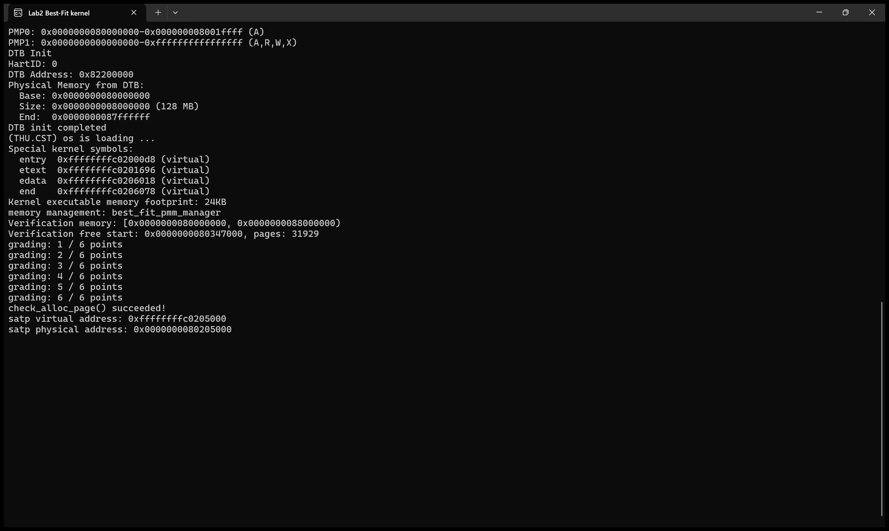

`make grade` 对该开发期配置评分，页面初始化与管理器选择检查均通过，总分 20/20。

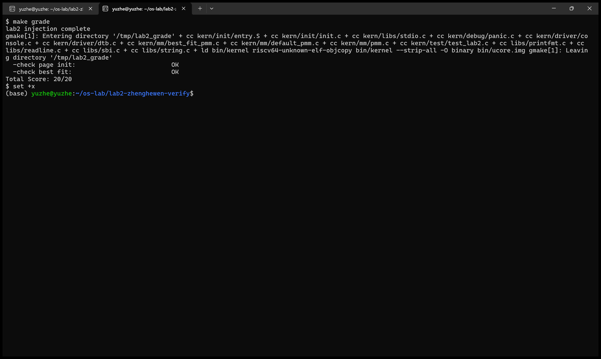

图4-2 为 Best-Fit 开发期评分；集成后的评分结果见图5-3。

独立行为测试直接调用分配器，使用逐页状态数组计算预期分配地址，并在每次操作后检查双向链接、地址顺序、范围重叠、相邻块合并、首页标志、引用计数和空闲总数。

| 检查项目 | 测试内容 | 结果 |
| --- | --- | --- |
| 原始测试 | `basic_check()`、`best_fit_check()` | 通过，6/6 |
| 最佳选择与拆分 | 最小足够块、精确匹配、同长低地址选择、余块位置 | 通过 |
| 连续空间不足 | 空闲块为 2、2、3 页，总计 7 页，申请 4 页 | 返回 `NULL`，原状态保持 |
| 回收与合并 | 先回收两侧，再回收中间；回收申请的子区间 | 通过 |
| 资源恢复 | 全部回收后重新整体申请 | 通过 |
| 多区间初始化 | 乱序登记、相邻区间高地址先登记、中间桥接及两侧扩展 | 通过 |
| 随机测试 | 5 个固定种子，各 5000 次混合申请与释放 | 25000 次操作通过 |

随机测试种子为 `0x00000001`、`0x20261016`、`0x00c0ffee`、`0x12345678`、`0xdeadbeef`。每组初始登记三个分离区间，共 224 页；全部回收后均恢复 224 页。包含定向案例与收尾操作，共完成 25226 次状态检查，地址和未定义行为检查无报错。

```text
ALL PASS: invariant_checks=25226 allocations=13125 releases=12062 random_operations=25000
```

#### 4.4.3 改进思考

设空闲块数为 B，分配最坏复杂度为 `O(B)`；登记或释放 n 页需要清理 n 个描述符并寻找插入位置，复杂度为 `O(n + B)`，定位后的两侧合并为 `O(1)`。

| 改进方案 | 作用 | 代价与适用条件 |
| --- | --- | --- |
| 按“块长、地址”建立平衡搜索树 | 按块长下界定位最小足够块，同长按地址选择，查找达到 `O(log B)` | 还需维护地址索引以寻找合并邻居；拆分、插入、删除和合并同步更新两套索引 |
| 按块长分桶并设置非空位图 | 快速定位常用页数的候选块 | 精确分桶需要较多桶；范围分桶仍需比较桶内块长，还要维护地址邻接关系 |
| 统计请求分布与碎片变化 | 结合最大空闲块、空闲块数及失败申请分析策略效果 | 增加统计开销，需要覆盖实际申请与释放模式 |

---

### 4.5 实现 Buddy System 物理页分配器

**负责人：2510718 李东**

#### 4.5.1 模块功能与核心函数

| 函数或对象 | 职责 |
|------------|------|
| `buddy_init()` | 初始化各阶空闲链表和空闲页计数 |
| `buddy_init_memmap(base, n)` | 将合法可用区间拆成按物理页号对齐的块，登记并尝试合并 |
| `buddy_alloc_pages(n)` | 向上取整请求，从相应阶或更高阶取块并拆分 |
| `buddy_free_pages(base, n)` | 按原申请页数确定阶数，回收整个取整块并逐级合并 |
| `buddy_nr_free_pages()` | 返回实际空闲页总数 |
| `buddy_check()` | 执行隔离自测，恢复真实分配器状态 |
| `buddy_pmm_manager` | 注册五个管理回调及 `check` 回调 |

Buddy 以阶数 k 表示大小为 $2^k$ 页的块。每阶有一个静态空闲链表，避免分配器为了管理空闲内存又依赖尚未建立的动态分配功能。块首页的 `Page.property` 保存 `order + 1`，内部页为 0；只有空闲块首页设置 `PG_property`。已分配块首页也保留阶数编码，以便释放时核对大小等级。

#### 4.5.2 需求约束与实现方法

**区间登记：**  
初始化区间必须合法、连续、尚未登记，且区间内各页的描述符仍为保留状态。算法先检查整个区间，再清理页状态；每次选择当前位置能够对齐、并且不超过剩余长度的最大二次幂块。相邻区间分批登记后，只有构成真正伙伴时才合并。

**申请与拆分：**  
申请 n 页时求最小的 $2^k \ge n$。若该阶为空，则向更高阶查找；取出大块后不断对半拆分，将右半块放回对应链表，保留左半块继续拆分。空闲计数扣除实际块长，而不是仅扣除 n。例如申请 3 页实际占用 4 页，申请 5 页占用 8 页。

**释放与合并：**  
以绝对物理页号 ppn 为基准，同阶伙伴页号为 `ppn ^ (1 << order)`。合并前必须确认伙伴完整落在管理范围内，非保留、处于空闲状态且阶数相同。满足条件时移除伙伴，以低地址首页代表上一阶块，继续检查；地址相邻本身不构成充分条件。

**接口约定：**  
释放时必须传入分配返回的首页和原申请页数，Buddy 会回收整个取整块，不支持子区间释放。零页申请、取整溢出或空间不足时返回 `NULL`，不改变分配器状态。

**复杂度与取舍：**  
设可用阶数为 K，查找、拆分及伙伴合并的链表操作最多跨越 O(K) 阶；释放实际块 m 页时还要逐页检查和清理描述符，因此本实现释放成本为 `O(m + K)`。二次幂的约束便于合并，但会产生内部碎片，且总空闲页数足够也不一定存在所需高阶块。

#### 4.5.3 实现迭代与接入过程

实现时先完成各阶链表、块阶数记录和五个管理回调，再补充 `buddy_check()` 及辅助测试。集成时添加公开声明，并通过 `USE_BUDDY_PMM` 切换管理器。

#### 4.5.4 测试覆盖与检查依据

`buddy_check()` 使用 64 个静态模拟页描述符建立隔离测试区，保存真实 `pages`、`npage`、各阶链表和计数，并保存、关闭本地中断。测试结束后恢复真实状态和原中断状态。该测试通过模拟描述符检查块管理与链表状态，不访问真实物理页内容。

| 测试类别 | 具体场景 | 能发现的问题 |
|----------|----------|--------------|
| 请求取整与互不重叠 | 1、2、3、5、9 页请求，期望实际占用 1、2、4、8、16 页；检查对齐及独立位图 | 取整错误、补齐页重复分配、越界 |
| 连续拆分 | 将 32 页区间逐步分配成单页块 | 拆分丢块、页数统计错误 |
| 合并与非伙伴区分 | 逐步释放恢复 32 页块；单独构造相邻但不是伙伴的空闲页 | 错误合并、漏合并、失效首页标记残留 |
| 不规则初始化 | 非大块对齐的 13 页区间、保留洞、相邻区间分次登记 | 错误对齐、越过可用边界、分配保留页 |
| 失败路径 | 空间耗尽、碎片使高阶申请失败、零页及超大请求 | 返回值错误、失败时修改状态 |
| 回收与恢复 | 按原申请页数释放、重新申请、恢复真实管理状态 | 补齐页泄漏、计数不恢复、破坏内核现场 |

#### 4.5.5 改进方向

当前实现适用于启动阶段单 hart 串行调用。若扩展到并发内核，需要为链表和计数建立同步机制；可进一步引入非空阶位图减少查找，并测试更大规模、不同顺序的分配与释放。

---

### 4.6 Challenge：简化 SLUB 对象分配器

**负责人：2510718 李东**

#### 4.6.1 模块功能与公开接口


```c
void slub_init(void);
void *slub_alloc(size_t size);
void slub_free(void *ptr);
void slub_check(void);
```

SLUB 解决按页申请小对象时的浪费：底层 PMM 提供整页，上层将页面划分为多个对象槽位。

#### 4.6.2 两层结构与实现方法

**小对象分类：**  
对象大小分为 16、32、64、128、256、512、1024、2048 字节八档，请求向上选择能够容纳它的最小档位。每个 slab 使用一页，页首存放 `struct slub_block`，随后是按 16 字节对齐的对象区。空闲对象在自身空间内存放下一空闲槽的指针；分配后这部分空间完全交给调用者。

**页内管理信息：**  
管理头保存标识、底层首页、原申请页数、大小类别、槽位总数、已使用数、空闲对象链表和 partial 链表节点。它存放在真实页面内，不修改 Buddy 使用的 `Page.property` 或 `Page.page_link`。当前 RV64 布局下管理头按对齐后占 80 字节，128 字节档每页容纳 31 个对象，2048 字节档每页容纳 1 个对象。

**分配与回收：**  
各档仅维护仍有空位的 slab。申请时优先从已有页的空闲链表取槽；无可用页则向 PMM 申请一页。页满时从 partial 链表移除；满页释放一个对象后重新进入链表；最后一个对象释放后立即把整页归还 PMM。因此已完全空闲的 slab 不会长期缓存。

**大对象：**  
超过 2048 字节的请求直接计算“管理头＋对象”所需页数，并调用 `alloc_pages`。例如 4096 字节对象还要容纳管理头，需申请 2 页。管理头记录传给 PMM 的原申请页数；释放时按该数归还，底层 Buddy 自动回收实际取整块。返回指针始终位于首个页面内，按页向下对齐即可找回管理头。

**地址与错误处理：**  
页描述符先转换为物理地址，再加 `va_pa_offset` 得到可访问的内核地址，并检查描述符范围和内核映射范围。零字节、溢出或内存不足返回 `NULL`，`slub_free(NULL)` 不做操作；地址转换失败时归还刚申请的页面。对象不会自动清零，正常释放只能传入本分配器返回且尚未释放的原始指针。

#### 4.6.3 测试覆盖与检查依据

SLUB 测试在真实 PMM 和 SLUB 已初始化、且没有未释放 SLUB 对象的启动阶段运行。成功用例至少需要 9 个空闲页，并能够分配两个连续 4 页块。测试使用静态记录保存指针、请求长度和数据标记，避免依赖被测试分配器来分配测试元数据。

| 测试类别 | 具体场景 | 能发现的问题 |
|----------|----------|--------------|
| 分类边界与对齐 | 覆盖 1、15、16、17 等档位邻界以及 2048/2049、4096/4097 等大对象边界 | 档位选择错误、容量不足、16 字节对齐失效 |
| 数据完整性与隔离 | 按每个对象实际请求长度逐字节写入标记并读回，比较对象区间 | 对象重叠、管理头侵入有效载荷、越界写坏邻居 |
| 跨页扩展与槽位复用 | 填满一个 128 字节档 slab 后继续申请；释放满页中的槽位再申请 | 满页链表状态错误、空位不能复用 |
| 页回收 | 逐步释放多个 slab 的对象，观察底层空闲页数 | 仍有对象时提前还页、空页未归还 |
| 大对象 | 多页对象读写，释放后核对页数恢复 | 连续空间不足、头部占用遗漏、释放参数不匹配 |
| 非法大小与失败状态 | 零字节、`NULL` 释放、超大及计算溢出请求 | 错误返回、失败泄漏或破坏现存对象 |
| 真实耗尽与恢复 | 持续申请 2048 字节对象直至底层无空闲页；保留小对象页空位及大对象作为对照 | 资源不足时的错误状态、已有对象损坏 |
| 耗尽后的可用空位 | 底层无空闲页时仍从已存在的未满 slab 分配；归还一页后再次扩展 | 错把“无新页”当成“所有对象请求都失败” |

#### 4.6.4 改进方向

后续可考虑保留少量空 slab，在同类对象反复释放和重新分配时复用页面，减少调用 PMM 的开销，但会占用一定的空闲内存。面向多核使用时，可进一步引入锁和每 hart 缓存，并补充并发压力测试。

---

### 4.7 GDB 分支任务：页表翻译与 QEMU 软件 TLB

**运行及截图：2511102 沈弋皓；分析与整理：2510718 李东。**

#### 4.7.1 调试对象与地址空间

使用宿主 GDB 调试带符号的 QEMU，用 RISC-V GDB 控制客体 ucore。宿主 GDB 中的 QEMU C 函数负责模拟地址翻译，客体内核则使用 RISC-V 虚拟地址。

#### 4.7.2 根据页表项计算物理地址

图5-6、图5-7 给出以下数据：

| 观察项 | 数值或含义 |
|--------|------------|
| 访问类型 | `MMU_INST_FETCH`，取指 |
| 虚拟地址 | `0xffffffffc02000d8` |
| `satp` | `0x8000000000080205`，MODE=8，即 Sv39 |
| 根页表物理地址 | `0x80205 × 0x1000 = 0x80205000` |
| 根级索引 | `VPN[2] = 0x1ff` |
| 本次根页表项地址 | `0x80205000 + 0x1ff × 8 = 0x80205ff8` |
| 页表项 | `0x200000cf`，PPN=`0x80000` |
| 低位权限/状态 | `0xcf`：V、R、W、X、A、D 置位 |
| QEMU 返回的物理页基址 | `0x80200000` |
| 完整物理地址 | `0x802000d8` |

Sv39 最多使用三级页表，但本次根项已经设置读、写、执行权限，是根级叶子，直接形成 **1 GiB 大页映射**，不需要继续读取两级下层页表。截图中 `i=0` 命中根级叶子与启动汇编相符。

计算完整地址时，将大页物理基址 `0x80000000` 与虚拟地址低 30 位 `0x002000d8` 相加，得到 `0x802000d8`。图5-7 中 QEMU 的 `get_physical_address()` 返回的是按 4 KiB 对齐的页基址 `0x80200000`，加上当前访问的页内偏移 `0xd8` 才是完整地址。

#### 4.7.3 TLB 填充与宿主地址转换

图5-8 的调用栈显示 `get_page_addr_code → tlb_fill → riscv_cpu_tlb_fill → tlb_set_page`。传给 `tlb_set_page()` 的虚拟页为 `0xffffffffc0200000`，物理页为 `0x80200000`，权限为 7，填充大小为 `0x1000`。

其中 4 KiB 是 QEMU 本次软件 TLB 条目的填充粒度；前面根页表叶子覆盖 1 GiB。软件 TLB 保存已求出的地址关系和访问标志，后续符合条件的访问可以走缓存路径，减少重复遍历页表。

---

## 五、测试与验证

**本章负责人：2511102 沈弋皓**

### 5.1 最终版本与运行配置

经过汇总，最终各配置在同一份集成源码上切换运行。默认构建使用 Best-Fit，以满足评分脚本要求；First-Fit、Buddy、SLUB通过编译宏分别构建。所有配置切换前均执行 `make clean`。

| 测试配置 | 编译与运行方式 |
|---|---|
| First-Fit | `make DEFS=-DUSE_DEFAULT_PMM`；`make qemu DEFS=-DUSE_DEFAULT_PMM` |
| Best-Fit | `make`；`make qemu` |
| 基础评分 | 默认 Best-Fit 下执行 `make grade` |
| Buddy | `make DEFS=-DUSE_BUDDY_PMM`；使用相同 `DEFS` 运行 QEMU |
| Buddy + SLUB | `make DEFS="-DUSE_BUDDY_PMM -DENABLE_SLUB_TEST"`；使用相同 `DEFS` 运行 QEMU |
| 页表与TLB调试 | 使用带调试信息的 QEMU 执行 `make QEMU=/mnt/e/wsl/OS/qemu-4.1.1/riscv64-softmmu/qemu-system-riscv64 debug`，宿主GDB附加QEMU，RISC-V GDB连接1234端口 |

### 5.2 测试结果汇总

| 验证项目 | 运行配置 | 实际结果 |
|---|---|---|
| 页面初始化 | 默认 Best-Fit | 识别128 MiB内存，建立32768个描述符，登记31929个空闲页；后置检查通过 |
| First-Fit运行检查 | `USE_DEFAULT_PMM` | 显示 `default_pmm_manager`，`check_alloc_page() succeeded!` |
| Best-Fit运行检查 | 默认配置 | 显示 `best_fit_pmm_manager`，统一分配检查通过 |
| 基础评分 | `make grade` | page init与best fit均为OK，总分20/20 |
| Buddy自测 | `USE_BUDDY_PMM` | `buddy_check() succeeded!`，统一分配检查通过；空闲页31925 |
| SLUB自测 | `USE_BUDDY_PMM`与`ENABLE_SLUB_TEST` | Buddy、统一分配检查和 `slub_check()` 均成功；空闲页31922 |
| 配置互斥 | 同时定义两个 PMM 宏 | 按回归记录，编译期按预期报错 |
| GDB页表与TLB调试 | 双GDB | 完成一次Sv39地址翻译并观察QEMU软件TLB构造 |

### 5.3 测试截图与输出

#### 图5-1 First-Fit运行与页面初始化

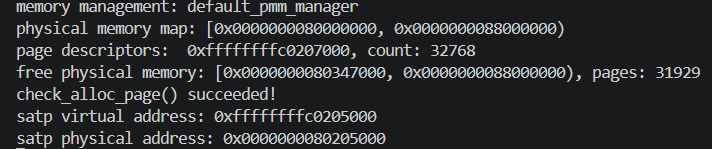

#### 图5-2 Best-Fit最终运行

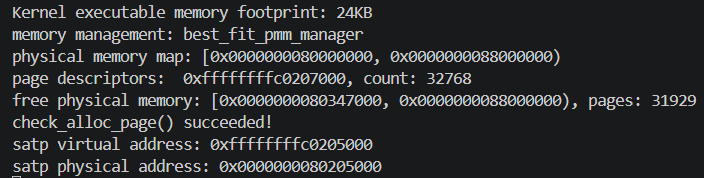

#### 图5-3 基础评分

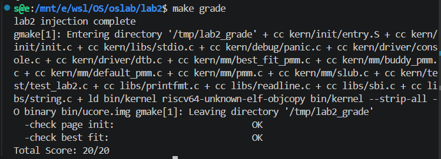

#### 图5-4 Buddy自测

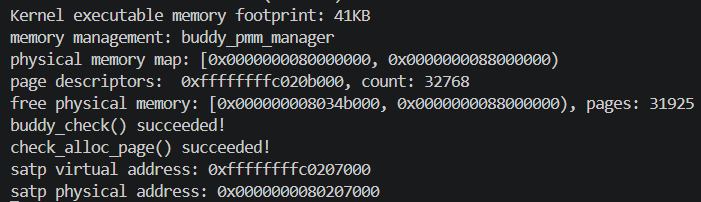

#### 图5-5 SLUB自测

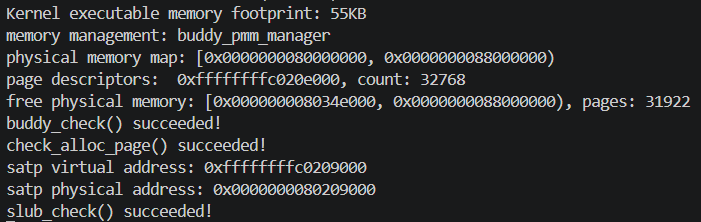

#### 图5-6 Sv39页表遍历

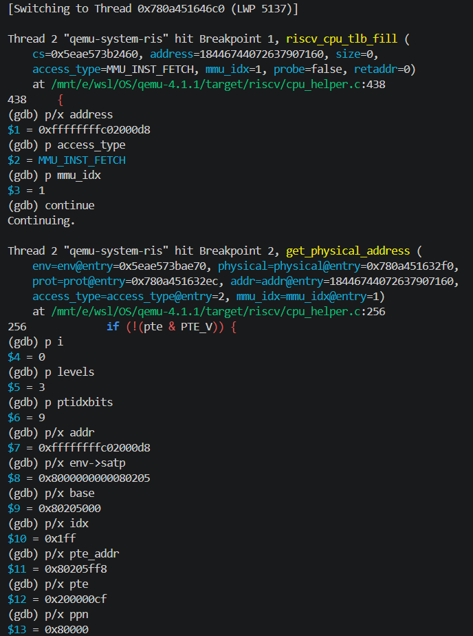

#### 图5-7 地址翻译结果

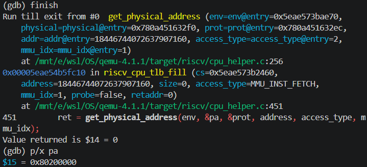

#### 图5-8 软件TLB填充调用链

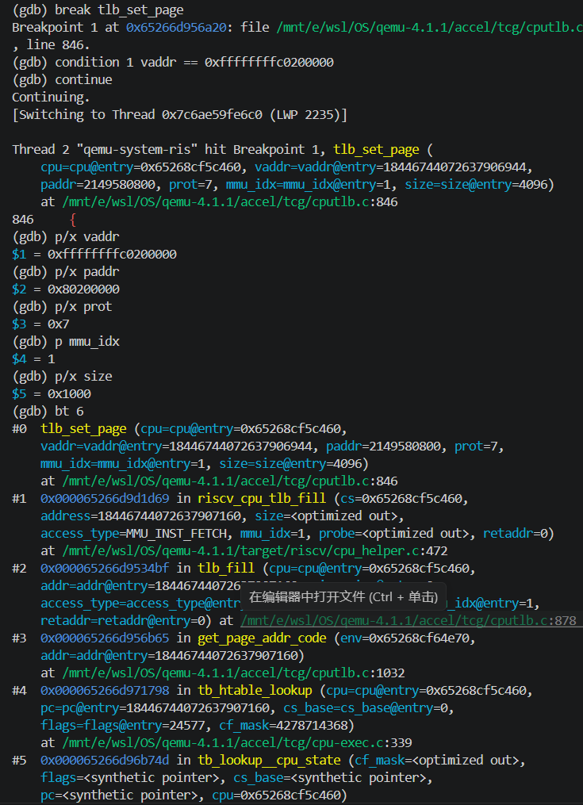

#### 图5-9 QEMU软件TLB表项

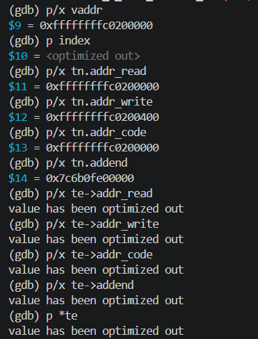

---

## 六、实验总结与收获

### 6.1 对操作系统内存管理的理解

| 实验中的知识点 | 对应的操作系统原理 | 本实验中的体现 |
|----------------|--------------------|--------------------|
| DTB 与保留区 | 物理内存发现、资源归属 | 根据 DTB 获取 RAM 范围，将内核和元数据占用页设为保留 |
| `Page` 与 PMM | 资源抽象、统一接口 | 描述符记录页面状态，函数表切换策略；相同签名仍需明确不同释放语义 |
| First-Fit、Best-Fit | 连续分配、外部碎片 | 选择策略不同，但都需要维护空闲块、拆分及邻接合并；总量足够不保证连续块足够 |
| Buddy | 二次幂分级、快速伙伴合并 | 用物理页号确定伙伴，付出取整导致的内部碎片；相邻并不一定能够合并 |
| SLUB | 小对象分配、分层管理 | 页层与对象层分别管理资源；头部开销、对象对齐和正确回收同样影响可用容量 |
| Sv39 与 TLB | 地址翻译和翻译缓存 | 页表表达映射，TLB 缓存结果；本次实际使用根级 1 GiB 映射及 QEMU 的 4 KiB TLB 填充 |
---

### 6.2 原理中重要但本实验未充分覆盖的内容

本实验尚未实现用户进程各自的地址空间、缺页异常处理、按需分页、页面置换与交换、写时复制、共享页引用管理等完整虚拟内存机制。

并发方面，Buddy 与 SLUB 约定启动期单 hart 串行调用，未提供完整的多核锁、每 CPU 缓存和跨核 TLB shootdown。

### 6.3 AI 协作开发的经验

接到任务时候，我先整体阅读实验要求，然后在AI带领下完成了队伍内部分工工作，力求任务模块耦合度低，便于各自独立完成后汇总到一个人手里。

之后，我们先仔细阅读各自部分的需求和目的，然后编写AI提示词，让AI完成代码的编写和测试，最终合并到一个人那里，完成最终汇总测试。

通过这次实验，我们增加了团队协作经验和AI协作开发经验，更加理解了AI时代如何和AI协作开发，高效且准确的完成开发任务。