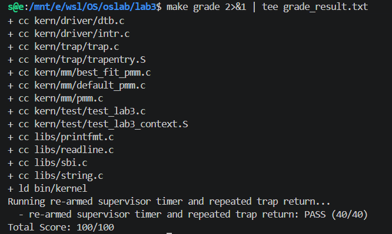
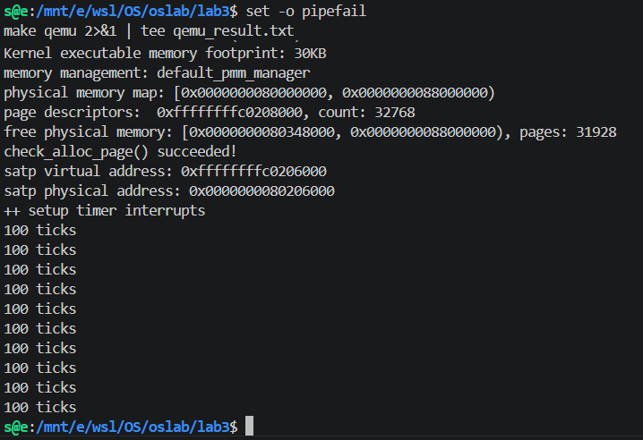

# Lab3：中断与异常处理实验报告

## 实验基本信息

| 项目 | 内容 |
|---|---|
| 实验名称 | Lab3：中断与异常处理 |
| **小组成员** | 2510718-李东、2511102-沈弋皓、2511170-郑贺文 |
| **完成日期** | 2026-11-2 |

### 小组分工

| 成员 | 练习与代码工作 | 报告任务 |
|---|---|---|
| 2510718 李东 | 实现 `RESTORE_ALL` 和 `__alltraps`，完成Trap入口、C函数调用和上下文恢复 | 完成报告4.1和其余部分的撰写 |
| 2511102 沈弋皓 | 实现 `exception_handler()`；补齐Lab2依赖；汇总代码并完成编译、运行和评分测试 | 完成报告4.3,4.4和5部分的撰写 |
| 2511170 郑贺文 | 实现 `interrupt_handler()`，完成中断分类、持续时钟、计数和关机 | 完成报告4.2部分的撰写 |

---

## 一、实验目的

1. 理解RISC-V中断与异常的区别，以及二者均为Trap的原因。
2. 理解 `stvec`、`sstatus`、`sepc`、`scause`、`sscratch` 等CSR在Trap过程中的作用。
3. 使用栈上的 `struct trapframe` 保存和恢复处理器上下文。
4. 建立汇编入口 `__alltraps` 与C函数 `trap()` 之间的调用关系。
5. 正确处理断点、非法指令和Supervisor时钟中断，并在处理完成后返回原执行流。
6. 在启用中断后，为物理内存管理的关键操作增加临界区保护。

---

## 二、实验环境

使用的 AI 工具

| 成员 | AI 编程工具 | 底层模型 | 备注 |
|------|------------|---------|------|
| 2510718-李东 | codex桌面版 | GPT-6 Astra 极高 | 无 |
| 2511102-沈弋皓 | OpenAI Codex 桌面应用 | GPT-5.6 Sol | 无 |
| 2511170-郑贺文 | Codex 桌面应用 | GPT-6 Astra | 无 |

---

## 三、实验整体逻辑分析

### 3.1 章节逻辑主线

本实验按照“初始化Trap入口—保存上下文—进入C处理函数—分类处理中断或异常—恢复上下文—返回原执行流”的顺序展开：

```text
内核初始化
  ├─ idt_init()设置stvec
  ├─ pmm_init()初始化物理内存
  ├─ clock_init()设置第一个时钟事件
  └─ intr_enable()打开S模式全局中断

发生Trap
  ↓
硬件写入sepc、scause等CSR，并跳转到stvec
  ↓
__alltraps → SAVE_ALL建立trapframe
  ↓
a0 = sp，调用trap(struct trapframe *tf)
  ↓
trap_dispatch()
  ├─ interrupt_handler()
  └─ exception_handler()
  ↓
RESTORE_ALL恢复CSR和通用寄存器
  ↓
sret从恢复后的sepc继续执行
```

### 3.2 中断与异常的关系

中断是与当前指令无直接关系的异步事件，例如时钟中断或者使用者的操作，os在每段指令执行结束后检查是否有中断发生，不会打断完整指令；异常是由当前指令同步触发的事件，例如除以0这种非法指令和 `ebreak`，这会使得这条指令直接无法执行，进而产生异常。`scause`最高位用于区分二者，剩余位表示具体原因。`trap_dispatch()`将两类Trap分别交给中断处理器和异常处理器。

中断通常不修改 `sepc`，因为被打断的执行应从原位置继续。异常是否修改 `sepc`取决于处理策略；本实验中的非法指令和断点都需要跳过触发异常的指令，否则返回后会再次执行同一指令并形成异常循环。

---

## 四、实验内容与实现

### 4.1 Trap上下文恢复与Trap入口

**负责人：2510718 李东**

#### 4.1.1 Trapframe布局

`struct trapframe`由32个通用寄存器和4个Trap相关CSR组成，共占36个 `uintptr_t`：

```text
0～31  ：x0～x31
32     ：sstatus
33     ：sepc
34     ：sbadaddr
35     ：scause
```

`SAVE_ALL`先把原始 `sp`写入 `sscratch`，再在栈上分配 `36 * REGBYTES`空间。由于分配后 `sp`已经指向Trapframe，原始 `sp`不能像普通寄存器一样直接保存，因此需要通过 `csrrw`取回并存入槽位2。

#### 4.1.2 `__alltraps`

Trapframe构造完成后，当前 `sp`就是 `struct trapframe *`。按照RISC-V调用约定，第一个参数使用 `a0`传递：

```asm
mv a0, sp
jal trap
```

调用C处理函数之前，原始 `a0`和 `ra`已经保存在Trapframe中，这样汇编入口就可以安全地覆盖它们了。

#### 4.1.3 `RESTORE_ALL`

恢复过程首先从偏移32、33取出 `sstatus`和 `sepc`并写回CSR，以保证 `exception_handler()`对 `tf->epc`的修改能够生效。随后恢复除 `sp`外的通用寄存器，最后执行：

```asm
LOAD x2, 2*REGBYTES(sp)
```

将Trap发生前的栈指针恢复。完成后由 `sret`根据恢复后的 `sepc`和 `sstatus`返回。

#### 4.1.4 需求说明与接口约束

本模块以已有的 `SAVE_ALL` 和 `struct trapframe` 为依据，保留现场布局与 `trap()` 接口，使保存、调用和恢复过程保持一致。入口将栈上的 Trapframe 地址按 RISC-V 调用约定传给 C 函数；恢复时按原槽位取回寄存器，并最后恢复 `sp`，避免丢失现场的基址。

由于恢复的目标是让原执行流继续运行，同时保留异常处理对返回位置的调整。因此，通用寄存器恢复为保存时的值，而 `sepc` 使用 C 处理函数处理后的 `tf->epc`。

### 4.2 中断处理

**负责人：2511170 郑贺文**

#### 4.2.1 中断分类

`tf->cause`最高位表示中断标志，实现先清除最高位，再根据剩余原因编号进入相应分支。已定义的软件、时钟和外部中断输出对应类型；未知中断输出原因编号并调用 `print_trapframe(tf)`保留完整现场。

#### 4.2.2 Supervisor时钟中断

时钟中断分支按以下顺序处理：

```text
clock_set_next_event()
→ ticks增加1
→ 每满100次调用print_ticks()
→ 统计输出次数
→ 输出达到10次后调用sbi_shutdown()
```

OpenSBI的定时器接口一次只设置一个事件，因此每次进入时钟处理器都必须重新设置下一次事件。时钟中断是异步事件，处理器不修改 `tf->epc`，返回后继续原执行流。

#### 4.2.3 需求说明与接口约束

本模块围绕持续时钟事件和中断分类设计。由于定时器接口一次只设置一个事件，每次 Supervisor 时钟中断都重新安排下一次事件，并将 `ticks` 增加一次；每累计 `TICK_NUM=100` 次输出一行 `100 ticks`，默认输出10次后关机。

时钟统计只由时钟中断更新，其他中断负责类型提示或未知原因的现场输出。处理过程中保留 Trapframe 中的通用寄存器、状态和返回地址，使正常处理结束后能够恢复原执行流。

### 4.3 异常处理

**负责人：2511102 沈弋皓**

#### 4.3.1 非法指令异常

评分用例使用：

```c
asm volatile(".word 0x0000007b");
```

该非法指令明确占4字节。处理器输出异常地址后执行：

```c
tf->epc += 4;
```

使 `sret`返回到下一条合法指令。

#### 4.3.2 断点异常

评分汇编中的 `ebreak`经实际工具链反汇编为：

```text
6a: 9002    ebreak
6c: ...     下一条指令
```

编码 `0x9002`是2字节压缩指令，因此断点分支执行：

```c
tf->epc += 2;
```

#### 4.3.3 未知异常

未要求恢复的异常进入默认分支，输出原因并调用 `print_trapframe(tf)`。评分用例构造 `cause=20`，输出中可看到十六进制 `0x14`，证明兜底分支正确保存了现场。

#### 4.3.4 需求说明与接口约束

本模块沿用 `trap_dispatch()` 和已有函数接口，重点保证异常处理后的返回位置正确。针对当前实验用例，非法指令占4字节、压缩断点占2字节，因此对应分支在输出异常信息后分别将 `tf->epc` 增加4或2，以避免返回后重复执行同一条异常指令。

### 4.4 Lab2依赖补齐与工程整合

**负责人：2511102 沈弋皓**

#### 4.4.1 `page_init()`适配

Lab3的 `pmm.c`调用 `page_init()`但初始骨架未提供定义。因此考虑将Lab2的实现适配进入Lab3，完成：

- 从DTB读取并验证物理内存范围；
- 设置虚实地址偏移和物理页总数；
- 在内核末尾按页对齐建立 `pages`数组；
- 初始化每个 `Page`描述符；
- 计算并注册可分配物理页区间；
- 对页地址转换、保留页和空闲页数进行自检。

Lab2实现使用了 `PHYSICAL_MEMORY_END`，而Lab3骨架没有该宏，因此考虑在 `memlayout.h`中补入与QEMU 128 MiB内存布局一致的 `0x88000000`上界。

#### 4.4.2 Best-fit依赖

Makefile会编译 `kern/mm`下所有源文件，即使当前选择的是 `default_pmm_manager`，`best_fit_pmm.c`也必须完整。初次编译报出了 `free_list`、`nr_free`未定义的错误，随后补入Lab2已完成的空闲链表、分配、释放、相邻块合并和管理器接口实现，解决了该问题。

#### 4.4.3 中断环境下的适配

本次试验中，我们不能用Lab2的整个 `pmm.c`，因为Lab3已在 `alloc_pages()`、`free_pages()`和 `nr_free_pages()`外额外增加：

```c
local_intr_save(intr_flag);
local_intr_restore(intr_flag);
```

这些临界区避免空闲页链表在修改过程中被异步中断打断。`page_init()`执行时全局中断尚未开启，因此它只负责初始化；Trap进入和返回由统一的Trap子系统负责。

## 五、测试与验证

### 5.1 构建验证

执行：

```bash
cd /mnt/e/wsl/OS/oslab/lab3
make clean
make
```

### 5.2 框架评分

执行：

```bash
make grade
```

结果：

| 测试 | 得分 | 验证内容 |
|---|---:|---|
| Trap入口、寄存器恢复和断点EPC | 35/35 | Trapframe传递、寄存器完整恢复、2字节断点跳过 |
| 非法指令返回 | 25/25 | 4字节非法指令跳过、中断和异常兜底分支 |
| 持续Supervisor时钟 | 40/40 | 重设时钟、重复Trap返回、`ticks=200` |
| 总分 | **100/100** | 全部通过 |



### 5.3 普通QEMU运行

普通运行成功识别128 MiB物理内存，建立32768个页面描述符，将 `[0x80348000, 0x88000000)`注册为空闲区，共31928页。输出 `check_alloc_page() succeeded!`说明物理内存管理自检通过。

时钟初始化后连续输出10行 `100 ticks`，随后通过SBI正常关机并返回Shell。该结果表明系统至少完成1000次时钟Trap的保存、处理、恢复和返回。



### 5.4 最终回归结论

- Lab2物理内存初始化和分配器检查通过。
- 断点异常能够跳过2字节压缩断点并保持寄存器上下文。
- 非法指令异常能够跳过4字节非法指令并继续执行。
- 未知中断和异常能够输出完整现场。
- Supervisor时钟中断可以持续重设并重复返回。
- QEMU能够在输出10次统计信息后正常关机。
- 最终框架总分为100/100，顺利通过测试。

## 六、实验总结与收获

### 6.1 重要知识点及与OS原理的关系

| 实验知识点 | OS原理中的含义 | 联系与差异 |
|---|---|---|
| Trap统一入口 | 中断和异常使控制权进入内核 | 实验使用Direct模式统一进入 `__alltraps`，真实系统可能使用更复杂的向量表 |
| Trapframe | 保存被打断执行流的上下文 | 它是进程切换和异常恢复的基础，但本实验尚未进行进程级上下文切换 |
| `sepc`更新 | 决定Trap返回位置 | 中断通常保持EPC，已处理的同步异常需要跳过触发指令 |
| 时钟中断 | 为抢占式调度提供周期事件 | 本实验只计数和打印，没有实现调度器 |
| OpenSBI | S模式内核与M模式固件接口 | 实验通过SBI设置定时器和关机，真实硬件平台接口可能不同 |

### 6.2 OS原理重要但本实验未覆盖的内容

1. 完整的用户态程序、系统调用和U/S特权级切换。
2. 缺页异常、按需分页和页面置换。
3. 外部设备中断、PLIC和真正的I/O驱动处理。
4. 多进程调度、抢占和完整的进程上下文切换。
5. 多核并发、IPI、自旋锁、内存屏障和缓存一致性。
6. 嵌套中断、可重入中断处理和中断优先级。
7. 信号机制以及用户态异常处理。

### 6.3 AI协作开发经验

接到任务时候，我先整体阅读实验要求，然后在AI带领下完成了队伍内部分工工作，力求任务模块耦合度低，便于各自独立完成后汇总到一个人手里。

之后，我们先仔细阅读各自部分的需求和目的，然后编写AI提示词，让AI完成代码的编写和测试，最终合并到一个人那里，完成最终汇总测试。

通过这次实验，我们增加了团队协作经验和AI协作开发经验，更加理解了AI时代如何和AI协作开发，高效且准确的完成开发任务。
