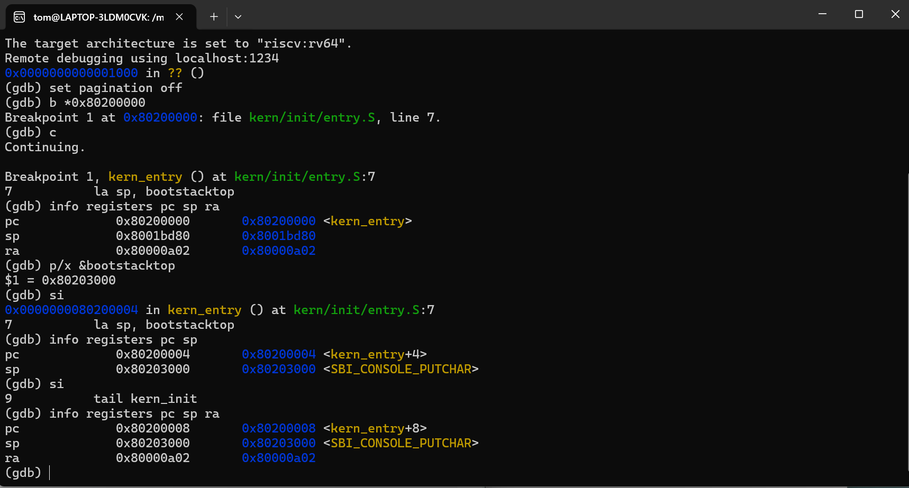
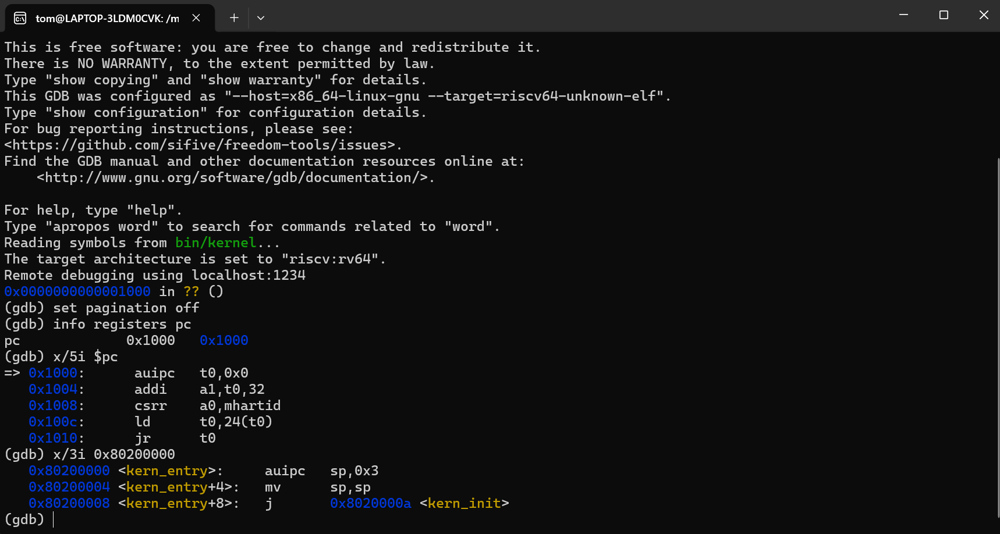
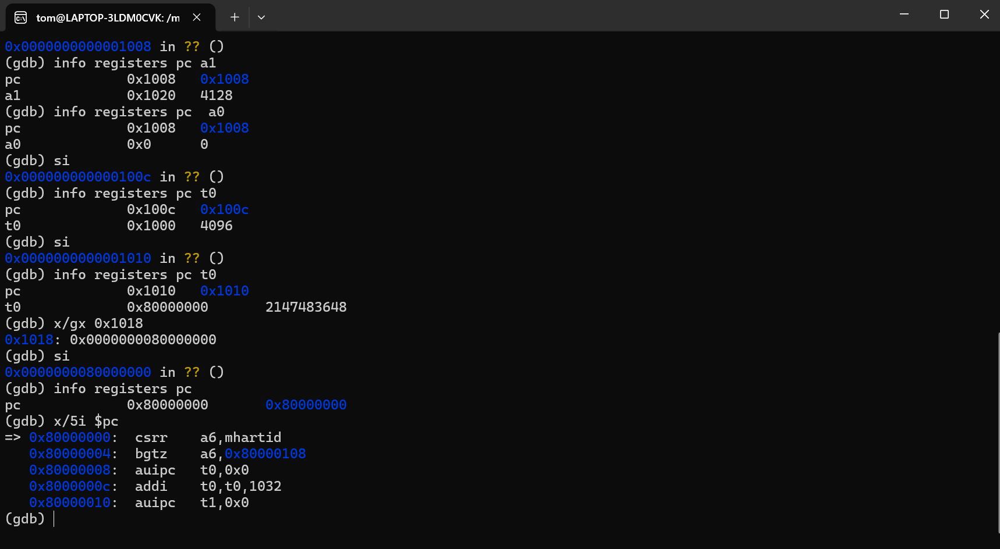
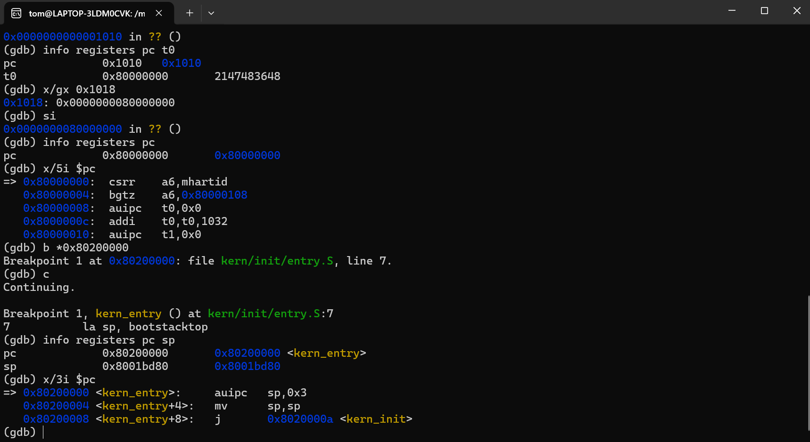
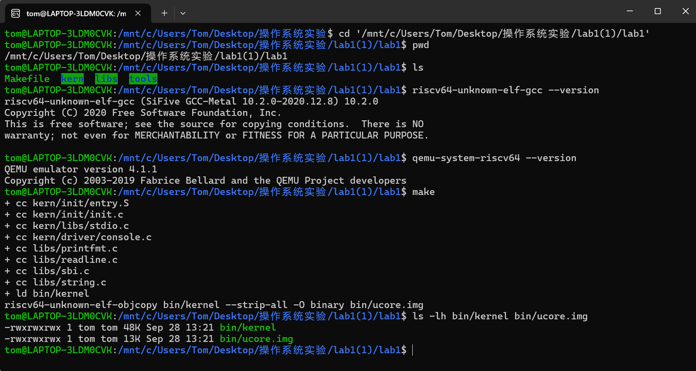
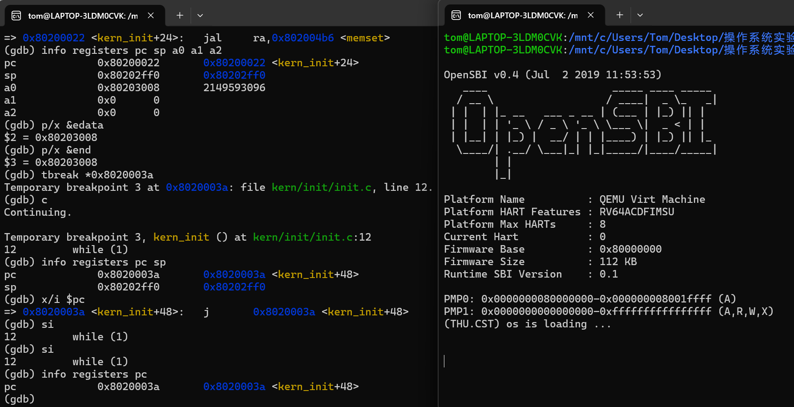

# 实验报告

## 实验基本信息

| 项目 | 内容 |
|------|------|
| **实验名称** | Lab1：比麻雀更小的麻雀（最小可执行内核） |
| **小组成员** | 2510718-李东、2511102-沈弋皓、2511170-郑贺文 |
| **本报告完成人** | 2510718-李东、2511102-沈弋皓、2511170-郑贺文 |
| **完成日期** | 2026-10-04 |

### 小组分工

| 成员 | 负责的练习/模块 |
|---|---|
| 2510718-李东 | 独立完成环境验证、内核运行、入口分析、GDB 启动流程调试、测试截图，负责报告4.3撰写和报告其余部分撰写工作 |
| 2511102-沈弋皓 | 独立完成环境验证、内核运行、入口分析、GDB 启动流程调试、测试截图，负责报告4.1撰写 |
| 2511170-郑贺文 | 独立完成环境验证、内核运行、入口分析、GDB 启动流程调试、测试截图，负责报告4.2撰写 |

---

## 一、实验目的

1. 理解 QEMU 模拟的 RISC-V 计算机从复位、执行 OpenSBI 到进入内核的启动过程。
2. 理解交叉编译、链接脚本和内核镜像之间的关系，分析内核入口、启动栈及基础输出功能。
3. 使用 GDB 观察指令、寄存器和内存，完成入口汇编分析与启动流程验证。

---

## 二、实验环境

| 组件 | 实际环境 |
|------|----------|
| 操作环境 | Windows 下的 WSL2，Ubuntu 24.04.4 LTS |
| 交叉编译器 | SiFive GCC-Metal 10.2.0，目标为 RISC-V 64 位 |
| 构建工具 | GNU Make 4.3，RISC-V Binutils 2.35 |
| 模拟器 | QEMU 4.1.1，`qemu-system-riscv64 -machine virt` |
| 固件 | QEMU 配套 OpenSBI v0.4，运行时 SBI 版本为 0.1 |
| 调试器 | SiFive GDB-Metal 10.1 |

---

使用的 AI 工具：

| 成员 | AI 编程工具 | 底层模型 | 备注 |
|------|------------|---------|------|
| 2510718-李东 | codex桌面版 | GPT-6 Astra 极高 | 无 |
| 2511102-沈弋皓 | OpenAI Codex 桌面应用 | GPT-5.6 Sol | AI 负责解释、提出检查步骤和整理报告 |
| 2511170-郑贺文 | Codex 桌面应用 | GPT-6 Astra | 环境配置、代码读取、命令执行、实验分析和报告整理 |


---

## 三、实验整体逻辑分析

### 3.1 本章节的逻辑主线

本实验围绕“让一个最小内核启动并输出信息”展开。使用已经提供的入口汇编、初始化函数和基础库，通过编译运行、阅读代码和 GDB 调试理解它们的关系。

构建时，交叉编译器将 C 和汇编源文件生成目标文件，链接器按 `tools/kernel.ld` 组合得到 ELF 文件 `bin/kernel`，再由 `objcopy` 转换为裸二进制镜像 `bin/ucore.img`。运行时的流程为：

```text
QEMU 预装固件和内核镜像
  → 0x1000：MROM 复位代码
  → 0x80000000：OpenSBI
  → 0x80200000：kern_entry 设置栈
  → kern_init 清零指定区域、输出信息
  → 进入while(1)无限循环
```

其中，本实验的 Makefile 使用 `-device loader,file=...,addr=0x80200000`，由 QEMU 预先装入内核，随后 OpenSBI 完成初始化并将控制权交给内核。

### 3.2 各部分的衔接

首先要通过链接脚本确定内存布局，使内核的链接地址、装载地址和执行入口相互配合。然后入口汇编设置启动栈，为 C 函数提供运行条件。进入 `kern_init` 后，再完成零初始化和控制台输出。这体现了各部分的依赖关系，即地址布局正确才能开始执行，有可用的栈才能可靠地调用后续函数。

---

## 四、实验内容与实现

### 4.1 最小内核的核心模块

**负责人：** [2511102-沈弋皓]

Makefile 完成从源文件到内核镜像的构建过程：

```text
C/汇编源文件
    → RISC-V 目标文件
    → bin/kernel（带符号信息的 ELF）
    → bin/ucore.img（供 QEMU 加载的二进制镜像）
```

ELF 文件保留入口地址、段布局和调试符号，因此 GDB 可以使用 `kern_entry` 等符号调试；二进制镜像则更适合直接映射到模拟机内存。

`tools/kernel.ld` 的关键内容包括：

- `ENTRY(kern_entry)`：指定 ELF 入口符号。
- `BASE_ADDRESS = 0x80200000`：指定内核基地址。
- `.text` 输出节收集各目标文件中的代码节。`entry.S` 将入口代码放在 `.text` 输入节中；本次链接结果中，`kern_entry` 的地址为 `0x80200000`。
- `. = ALIGN(0x1000)`：将数据段对齐到 4 KiB 边界。
- `PROVIDE(edata = .)` 与 `PROVIDE(end = .)`：向 C 代码提供 `.bss` 的边界。

结合链接脚本与符号表，本次内核的主要节与边界符号地址如下：

```text
.text    0x80200000
.rodata  0x802004c8
.data    0x80201000
edata    0x80203008
end      0x80203008
```

由于 `edata` 与 `end` 相同，本次最小内核没有实际的 `.bss` 内容，故清零长度为零。

### 4.2 练习 1：理解内核启动中的程序入口操作

**负责人：** [2511170-郑贺文]

入口代码为：

```asm
kern_entry:
    la sp, bootstacktop
    tail kern_init
```

**（1）`la sp, bootstacktop` 的作用与目的**

这条伪指令把 `bootstacktop` 的地址写入栈指针 `sp`。栈空间由 `.space KSTACKSIZE` 预留，两个头文件中定义每页 4096 字节、栈占两页，因此总大小为 8192 字节。符号表给出的范围为 `[0x80201000, 0x80203000)`。

栈向低地址增长，初始为空时，`sp` 指向高地址边界。设置它是为了让后续 C 函数能够保存返回地址、寄存器及局部数据。

当前反汇编为：

```asm
0x80200000: auipc sp,0x3
0x80200004: mv    sp,sp
0x80200008: j     0x8020000a <kern_init>
```

前两条指令对应 `la`。其中 `auipc` 计算 `0x80200000 + (0x3 << 12) = 0x80203000`；后面的 `mv sp,sp` 是零偏移加法的别名，保持该值不变。GDB 中，入口处的 `sp` 为 `0x8001bd80`，单步后变为 `0x80203000`，与符号地址一致。



**（2）`tail kern_init` 的作用与目的**

这条尾调用伪指令将执行流程交给 C 语言初始化函数，并且没有保存返回到入口汇编的地址。单步执行后，PC 从 `0x80200008` 变为 `0x8020000a`，`sp` 仍为 `0x80203000`，`ra` 仍为 `0x80000a02`。

它完成了汇编入口到 C 函数的交接。`kern_init` 最终停在无限循环中，因此也不会返回入口代码。后续在函数内部调用 `memset`、`cprintf` 时，仍使用普通函数调用机制。

### 4.3 练习 2：使用 GDB 验证启动流程

**负责人：** [2510718-李东]

**（1）启动调试并观察复位位置**

在 Lab1 目录的两个 Ubuntu 终端中分别运行 `make debug` 和 `make gdb`。前者通过 `-S` 暂停虚拟 CPU，并通过 `-s` 开启调试端口；后者加载 `bin/kernel` 的符号并连接 `localhost:1234`。

连接后执行：

```gdb
set pagination off
info registers pc
x/5i $pc
x/3i 0x80200000
```

PC 为 `0x1000`，说明复位后首先执行的是 MROM 中的代码。同时，`0x80200000` 已经能读到内核入口指令，验证了镜像在 CPU 执行内核之前已经装入内存。



**（2）最初几条指令的位置和功能**

| 地址 | 指令 | 作用 |
|------|------|------|
| `0x1000` | `auipc t0,0` | 将当前地址 `0x1000` 作为后续地址计算的基准 |
| `0x1004` | `addi a1,t0,32` | 将设备树地址 `0x1020` 放入参数寄存器 `a1` |
| `0x1008` | `csrr a0,mhartid` | 读取硬件线程编号，作为启动参数传给下一阶段 |
| `0x100c` | `ld t0,24(t0)` | 从 `0x1018` 读取 8 字节的固件入口地址 |
| `0x1010` | `jr t0` | 跳转到 `0x80000000`，开始执行 OpenSBI |

通过 `si` 单步并检查寄存器，可以看到 `t0` 先为 `0x1000`，随后变为 `0x80000000`。`x/gx 0x1018` 显示该位置保存的正是 `0x0000000080000000`。执行最后的跳转后，PC 到达 `0x80000000`。

这说明，最初这几条指令主要准备设备树、硬件线程编号等参数，并将执行权交给固件。



**（3）从 OpenSBI 到内核入口**

进入固件后，在内核第一条指令处设置断点：

```gdb
b *0x80200000
c
info registers pc sp
x/3i $pc
```

GDB 命中 `kern_entry`，PC 为 `0x80200000`，当前指令对应 `la sp, bootstacktop`。此时首条内核指令尚未执行，随后练习 1 中的单步操作验证了它的执行效果。OpenSBI 的内部初始化通过继续运行跨过，关键交接位置由断点确认。



### 4.4 操作中遇到的问题

单步复位代码时，由于疏忽，导致我在两次 `info registers` 之间漏执行一次 `si`，导致 PC 停在 `0x100c`、`t0` 仍为 `0x1000`。之后经过我检查指令位置后确认 `ld` 尚未执行，补做单步后得到正确结果。

此外，我最初将 `edata/end` 与栈的两端混淆。之后在AI的讲解下和我结合 `memset` 参数后确认，启动栈由 `bootstack/bootstacktop` 确定，`edata/end` 则用于确定零初始化区域，两者使用的不是同一块内存。

---

## 五、测试与验证

### 5.1 编译和启动

执行 `make`，成功生成 `bin/kernel` 和 `bin/ucore.img`。ELF 文件头显示目标为 RISC-V、入口为 `0x80200000`；`make qemu` 后，OpenSBI 启动并输出内核信息。



### 5.2 栈使用与零初始化参数

在 `0x80200022` 设置一次性断点，停在 `memset` 调用前，实际读到：

```text
sp = 0x80202ff0
a0 = 0x80203008
a1 = 0
a2 = 0
edata = end = 0x80203008
```

`sp` 比初始值减少了 16 字节，说明 `kern_init` 已建立自身栈帧。其中前三个参数分别对应 `memset(edata, 0, end - edata)` 的起始地址、填充值和长度。

### 5.3 输出与无限循环

在 `0x8020003a` 设置一次性断点并继续执行，QEMU 输出：

```text
(THU.CST) os is loading ...
```

此时当前下一条指令为 `j 0x8020003a`。继续单步，PC 仍为同一地址，确认打印后进入了源码中的 `while (1)`，即死循环。



综上所述，上述验证覆盖了编译、启动、入口汇编、清零参数和最终循环，测试完整齐全。

---

## 六、实验总结与收获

### 对操作系统的理解

| 本实验的重要知识点 | 与 OS 原理的联系及区别 |
|--------------------|-----------------------|
| 启动与程序装载 | 程序需要先进入内存，CPU 才能执行。本实验由 QEMU 预装镜像，这简化了实际启动中从存储设备读取内核的过程 |
| 链接与内存布局 | 链接器确定代码、数据和符号地址 |
| 栈与运行环境 | 函数调用需要栈和调用约定。普通应用的环境通常由系统及运行时准备，内核入口则需要自行设置启动栈 |
| 特权级与受控调用 | 内核通过 `ecall` 请求 M 模式的 SBI 服务；它与用户程序向内核发起系统调用的层次不同 |

### AI 协作开发的经验

本次我利用 AI ，给我讲解实验原理、解释指导手册和代码、提供调试步骤，具体的编译运行和 GDB 操作均为我在 AI 指导下学习完成，这次和AI的协作，不仅加深我对操作系统的理解，也让我对后续实验有了更大的兴趣！
