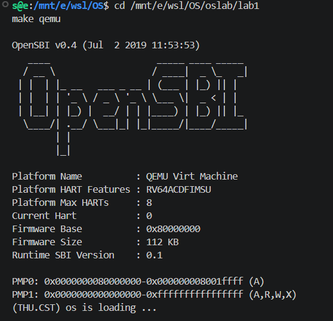
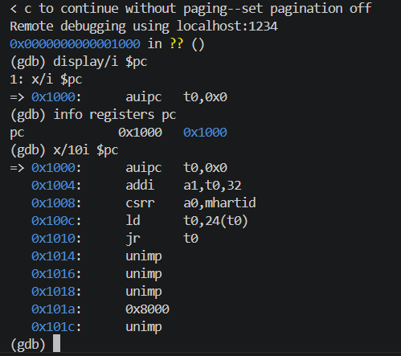
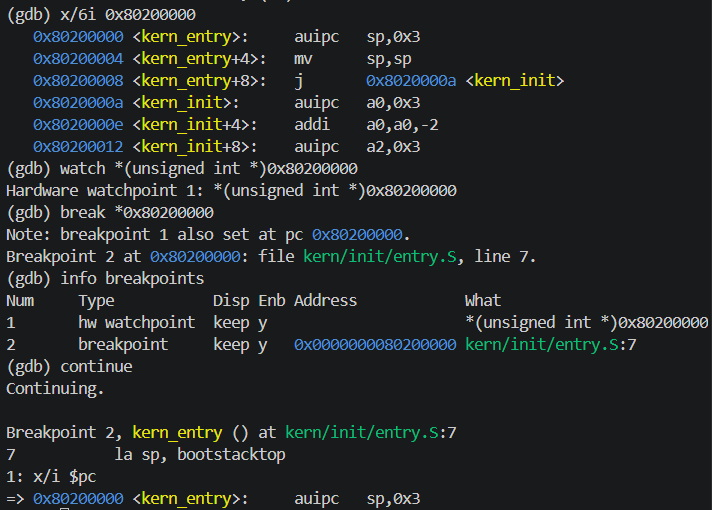
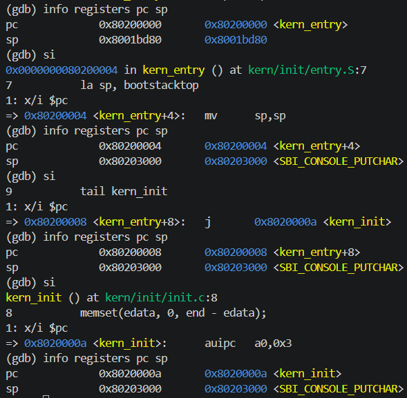

# 实验报告

## 实验基本信息

| 项目 | 内容 |
|---|---|
| **实验名称** | Lab 1：比麻雀更小的麻雀（最小可执行内核） |
| **小组成员** | 2510718-李东、2511102-沈弋皓、2511170-郑贺文 |
| **本报告完成人** | 2511102-沈弋皓 |
| **完成日期** | 2026-09-26 |

### 小组分工

本课程使用小组仓库组织提交，但 Lab 1 为个人独立实验。本报告仅记录沈弋皓本人完成实验的过程，不虚构组内协作内容。

| 成员 | 负责的练习/模块 |
|---|---|
| 2510718-李东 | 独立完成个人 Lab 1，不纳入本报告实施记录 |
| 2511102-沈弋皓 | 独立完成环境验证、内核运行、入口分析、GDB 启动流程调试、测试截图与实验报告 |
| 2511170-郑贺文 | 独立完成个人 Lab 1，不纳入本报告实施记录 |

---

## 一、实验目的

本实验的主要目的是：

1. 理解 RISC-V 计算机从加电复位、运行 OpenSBI 到进入 ucore 内核的启动流程。
2. 理解链接脚本如何规定内核的入口地址和 `.text`、`.rodata`、`.data`、`.bss` 等段的内存布局。
3. 理解 `kern/init/entry.S` 如何建立内核栈并将程序执行流交给 C 语言函数 `kern_init()`。
4. 理解内核在没有 Linux 和 glibc 支持的情况下，如何通过 SBI 调用逐层构造格式化输出功能。
5. 掌握使用 QEMU 和 GDB 调试 RISC-V 裸机程序的基本方法，并用实际寄存器和反汇编结果验证启动过程。

---

## 二、实验环境

| 项目 | 配置 |
|---|---|
| 宿主环境 | Windows + WSL Ubuntu |
| 实验代码目录 | `/mnt/e/wsl/OS/oslab/lab1` |
| RISC-V 交叉编译器 | `riscv64-unknown-elf-gcc 10.2.0`（SiFive GCC-Metal 10.2.0-2020.12.8） |
| 模拟器 | QEMU 4.1.1 |
| 调试器 | `riscv64-unknown-elf-gdb 10.1`（SiFive GDB-Metal 10.1.0-2020.12.7） |
| 固件 | OpenSBI v0.4，Runtime SBI Version 0.1 |

### AI 工具

| 成员 | AI 编程工具 | 底层模型 | 备注 |
|---|---|---|---|
| 2511102-沈弋皓 | OpenAI Codex 桌面应用 | GPT-5.6 Sol | AI 负责解释、提出检查步骤和整理报告；所有命令均由本人逐步执行并核对结果，未让 AI 一键完成实验 |

---

## 三、实验整体逻辑分析

### 3.1 本章节的逻辑主线

Lab 1 围绕“构造并理解一个能够运行的最小内核”展开。完整执行流为：

```text
QEMU 模拟加电
    ↓
CPU 从复位地址 0x1000 执行 MROM 代码
    ↓
跳转到 0x80000000，运行 OpenSBI
    ↓
OpenSBI 完成机器级初始化
    ↓
跳转到 0x80200000，执行 kern_entry
    ↓
建立内核栈并进入 kern_init
    ↓
清零 .bss、输出启动信息、进入无限循环
```

QEMU 提供虚拟的 RISC-V 64 位计算机；OpenSBI 运行在 M 模式，负责底层初始化和 SBI 服务；ucore 内核运行在 S 模式。本实验中的 QEMU 命令使用 `-device loader,file=...,addr=0x80200000`，因此内核镜像在 CPU 执行前已经被放置到 `0x80200000`，OpenSBI 初始化完成后再把控制权转交给该地址。

### 3.2 功能的逐步实现与验证

1. **使用交叉编译工具链构建内核**：宿主机是 x86-64，而目标计算机是 RISC-V 64，因此使用 `riscv64-unknown-elf-gcc` 生成目标代码。
2. **使用链接脚本规定内存布局**：`tools/kernel.ld` 将内核基地址设为 `0x80200000`，并将 `kern_entry` 放到 `.text` 最前方。
3. **建立内核执行环境**：`entry.S` 把 `sp` 设置为 `bootstacktop`，再尾跳转到 `kern_init()`。
4. **初始化 C 环境**：`kern_init()` 清零 `.bss`，使未初始化全局变量符合 C 语言语义。
5. **建立输出链**：`cprintf` 经过格式化、控制台抽象和 SBI 封装，最终用 `ecall` 请求 OpenSBI 输出字符。
6. **使用 QEMU 运行**：`make qemu` 成功显示 `(THU.CST) os is loading ...`。
7. **使用 GDB 验证**：实际观察 `0x1000 → 0x80000000 → 0x80200000`，并确认栈指针最终为 `0x80203000`。

---

## 四、实验内容与实现

### 4.1 项目构建与链接

**负责人：** 2511102-沈弋皓

Makefile 完成从源文件到内核镜像的构建过程：

```text
C/汇编源文件
    → RISC-V 目标文件
    → bin/kernel（带符号信息的 ELF）
    → bin/ucore.img（供 QEMU 加载的二进制镜像）
```

ELF 文件保留入口地址、段布局和调试符号，因此 GDB 可以使用 `kern_entry` 等符号调试；二进制镜像则更适合直接映射到模拟机内存。

`tools/kernel.ld` 的关键内容包括：

- `ENTRY(kern_entry)`：指定 ELF 入口符号。
- `BASE_ADDRESS = 0x80200000`：指定内核基地址。
- 首先放置 `.text.kern_entry`：保证第一条内核指令位于 `0x80200000`。
- `. = ALIGN(0x1000)`：将数据段对齐到 4 KiB 边界。
- `PROVIDE(edata = .)` 与 `PROVIDE(end = .)`：向 C 代码提供 `.bss` 的边界。

通过 `readelf` 得到本次内核的主要段地址：

```text
.text    0x80200000
.rodata  0x802004c8
.data    0x80201000
edata    0x80203008
end      0x80203008
```

由于 `edata` 与 `end` 相同，本次最小内核没有实际的 `.bss` 内容，清零长度为零；但相关初始化机制已经为后续实验准备好。

### 4.2 内核入口与栈初始化

**负责人：** 2511102-沈弋皓

`nm` 显示的关键符号地址如下：

```text
0000000080200000 T kern_entry
000000008020000a T kern_init
0000000080201000 D bootstack
0000000080203000 D bootstacktop
```

因此内核栈大小为：

```text
0x80203000 - 0x80201000 = 0x2000 = 8192 字节 = 8 KiB
```

入口反汇编结果为：

```asm
80200000: 00003117    auipc sp,0x3
80200004: 00010113    mv    sp,sp
80200008: a009        j     8020000a <kern_init>
```

`la sp, bootstacktop` 是伪指令，在本次构建中展开为 `auipc` 与 `mv`。执行后 `sp` 等于 `0x80203000`。RISC-V 栈从高地址向低地址增长，因此该地址表示空内核栈的初始栈顶。

`tail kern_init` 被汇编为不保存返回地址的直接跳转。由于 `kern_init()` 被声明为 `noreturn` 并最终进入无限循环，入口代码不需要保存返回地址，也不会再次获得控制权。

### 4.3 C 内核入口与输出链

**负责人：** 2511102-沈弋皓

`kern_init()` 完成以下工作：

1. 使用 `memset(edata, 0, end - edata)` 清零 `.bss`。
2. 调用 `cprintf` 输出启动信息。
3. 进入 `while (1)`，防止 CPU 执行到未知区域。

本实验使用的 `stdio.h`、`string.h` 并非 Linux 的 glibc，而是项目自己的内核库。内核正在建立自己的操作系统环境，不能依赖另一个操作系统提供的 `printf`。

输出链为：

```text
cprintf
→ vcprintf / vprintfmt
→ cputch
→ cons_putc
→ sbi_console_putchar
→ sbi_call
→ ecall
→ OpenSBI
→ QEMU 控制台
```

`vprintfmt` 通过 `cputch` 回调将格式解析和底层输出分离。这样，上层只负责 `%s`、`%d` 等格式，下层只负责输出一个字符。

在 `sbi_call` 中，`x17/a7` 保存 SBI 服务编号，`x10/a0`、`x11/a1`、`x12/a2` 保存参数。`ecall` 不会让内核永久提升权限，而是触发一次从 S 模式到 M 模式的受控调用，由 OpenSBI 完成字符输出，再返回内核。

### 4.4 AI 协作与迭代过程

本实验主要是理解和验证已有最小内核，没有要求生成或补全核心代码。AI 的作用是提出逐步检查命令、解释观察结果并帮助整理报告，实际命令、截图和判断均由本人完成。

#### 第一次迭代：环境确认与运行

- 确认 GCC、QEMU 和 GDB 版本满足实验要求。
- 在 `/mnt/e/wsl/OS/oslab/lab1` 执行 `make qemu`。
- 成功看到 OpenSBI 信息和 `(THU.CST) os is loading ...`。

#### 第二次迭代：静态分析

- 使用 `nm` 查看符号地址。
- 使用 `readelf` 查看 ELF 入口和段布局。
- 使用 `objdump` 查看伪指令展开后的真实 RISC-V 指令。
- 确认 `kern_entry = 0x80200000`，栈大小为 8 KiB。

#### 第三次迭代：动态调试

- 使用 `make debug` 启动暂停状态的 QEMU。
- 使用 `make gdb` 连接本机 1234 端口。
- 逐条验证复位代码和 OpenSBI 跳转。
- 在 `0x80200000` 设置断点，确认进入 `kern_entry`。
- 单步执行入口代码，确认 `sp` 从 `0x8001bd80` 变为 `0x80203000`，随后进入 `kern_init`。

#### 自动评分脚本异常

执行 `make grade` 时得到：

```text
sh: 0: cannot open tools/grade.sh: No such file
make: *** [Makefile:195: grade] Error 2
```

进一步检查发现，`lab1/tools/` 中只有 `function.mk` 和 `kernel.ld`，并且整个 `oslab` 目录都不存在 `grade.sh`。因此该错误属于实验代码包缺少评分脚本，不是内核编译或运行失败。本报告使用 `make qemu` 和 GDB 调试结果作为验证证据。

### 4.5 最终有效提示词

本实验最重要的约束提示词是：

```markdown
我之前没有接触过 OS 方面的知识，需要深入浅出讲解。现在要进行 Lab 1 的实验，指导我而不是替我一键完成。
```

这一约束使协作过程始终采用“本人执行命令、AI 解释原理、根据真实输出继续”的方式。完整提示词记录见 `prompt.md`。

---

## 五、练习解答

### 练习 1：理解内核启动中的程序入口操作

**负责人：** 2511102-沈弋皓

为验证内核入口和相关符号的实际地址，我使用 `nm`、`readelf` 和 `objdump` 查看了内核 ELF 文件的符号表、入口地址与反汇编结果。ELF 文件中记录的入口地址为 `0x80200000`，与 `kern_entry` 的地址一致。

`la sp, bootstacktop` 将栈指针 `sp` 初始化为 `bootstacktop` 的地址 `0x80203000`。`bootstack` 位于 `0x80201000`，因此内核栈共有 `0x2000` 字节，即 8 KiB。由于栈从高地址向低地址增长，将 `sp` 设置到 `bootstacktop` 可以为后续 C 函数调用准备可用的内核栈。

`tail kern_init` 将程序执行流交给 `kern_init`。反汇编表明它被转换为不保存返回地址的直接跳转指令 `j`。由于 `kern_init` 最终不会返回，因此无须在 `ra` 中保存返回地址，内核入口代码也不会再次获得控制权。

### 练习 2：使用 GDB 验证启动流程

**负责人：** 2511102-沈弋皓

GDB 连接 QEMU 后，CPU 首先停在复位地址 `0x1000`。最初的指令为：

```asm
0x1000: auipc t0,0x0
0x1004: addi  a1,t0,32
0x1008: csrr  a0,mhartid
0x100c: ld    t0,24(t0)
0x1010: jr    t0
```

这些指令完成的工作如下：

1. `auipc t0,0x0` 使 `t0 = 0x1000`。
2. `addi a1,t0,32` 使 `a1 = 0x1020`，准备固件启动信息地址。
3. `csrr a0,mhartid` 读取硬件线程编号，本次结果为 `a0 = 0`。
4. `ld t0,24(t0)` 从 `0x1018` 读取 64 位跳转地址。`x/gx 0x1018` 显示该值为 `0x80000000`。
5. `jr t0` 将 PC 设置为 `0x80000000`，CPU 开始执行 OpenSBI。该地址第一条观察到的指令为 `csrr a6,mhartid`。

随后在 `0x80200000` 设置写监视点和执行断点。继续运行后，写监视点没有触发，执行断点直接命中 `kern_entry`。结合 Makefile 中的 QEMU loader 参数，可以判断本实验的内核镜像已在 CPU 执行前被放入 `0x80200000`；OpenSBI 完成初始化后直接跳转到这里。

命中内核入口时，OpenSBI 留下的栈指针为 `0x8001bd80`。单步执行 `la sp, bootstacktop` 后，`sp` 变为 `0x80203000`；执行 `tail kern_init` 后，PC 变为 `0x8020000a`，进入 `kern_init()`。这与静态反汇编分析完全一致。

---

## 六、测试与验证

### 6.1 内核运行

执行 `make qemu` 后，QEMU 成功运行 OpenSBI，并输出：

```text
(THU.CST) os is loading ...
```



### 6.2 复位入口

GDB 显示 CPU 初始 PC 为 `0x1000`，并成功反汇编最初的复位指令。



### 6.3 内核入口

在 `0x80200000` 设置断点后成功命中 `kern_entry`。



### 6.4 栈初始化与进入 C 内核

单步调试确认 `sp` 被设置为 `0x80203000`，随后跳转到 `kern_init`。



### 6.5 自动评分说明

仓库 Makefile 中存在 `grade` 目标，但实验包未提供其依赖的 `tools/grade.sh`，因此无法执行自动评分。该情况已通过目录检查确认；内核本身能够正常编译、运行，并通过 GDB 完成启动流程验证。

---

## 七、实验总结与收获

### 7.1 对操作系统的理解

本实验涉及的重要知识点包括：

1. **启动链**：操作系统无法把自己从存储设备加载到内存，必须由更早运行的固件或引导程序完成初始化和控制权交接。
2. **特权级**：OpenSBI 运行在 M 模式，ucore 内核运行在 S 模式。内核通过 `ecall` 请求更高特权级提供 SBI 服务，但不会永久获得 M 模式权限。
3. **链接与内存布局**：编译只产生目标文件，链接脚本决定各段的最终地址和程序入口。内核不能使用适合普通应用程序的默认链接布局。
4. **ELF 与二进制镜像**：ELF 包含段信息、入口和调试符号，适合链接和调试；纯二进制镜像适合直接映射到目标内存。
5. **栈与函数调用**：进入 C 函数之前必须准备有效的栈。`entry.S` 是硬件/固件环境与 C 内核之间的桥梁。
6. **固件服务与系统调用的相似性**：S 模式内核通过 `ecall` 请求 M 模式 OpenSBI，与以后用户程序通过系统调用请求 S 模式内核在思想上相似，但调用双方和服务内容不同。

OS 原理中重要、但尚未在 Lab 1 中真正实现的内容包括：

- 物理内存管理、虚拟内存与页表；
- 中断和异常的完整处理机制；
- 用户态进程、系统调用和进程切换；
- 调度算法；
- 同步与互斥；
- 文件系统和设备驱动。

Lab 1 的价值在于先建立最小可运行骨架，为后续逐步加入这些功能提供稳定入口。

### 7.2 AI 协作开发的经验

本次实验没有让 AI 直接代替本人完成代码，而是把 AI 作为讲解和调试助手。每一步都先在本机执行，再把实际输出作为下一步分析依据。例如，`nm`、`readelf`、`objdump` 和 GDB 的结果共同验证了入口地址、伪指令展开和栈初始化，避免只依据文字说明作出未经验证的结论。

当 `make grade` 失败时，没有立即修改代码或复制其他实验的脚本，而是先检查 Makefile、`tools/` 目录和整个实验树，最终确认错误来自实验包缺少 `grade.sh`。这说明 AI 协作中最重要的不是快速给出答案，而是区分代码问题、工具问题和实验材料问题，并保留可复现的证据。

通过本实验，我对“加电后 CPU 如何一步步进入操作系统”形成了具体认识：启动不再只是抽象概念，而是可以通过地址、指令、寄存器和断点逐步观察的真实过程。
